# 🛡️ Awesome Remote Incident Remediation & Forensics (DFIR)

  
  
  
  
  
  

  <b>A curated catalog of enterprise SaaS platforms and production-grade open-source tools for remote incident remediation, digital forensics, live endpoint response, and enterprise DFIR (Digital Forensics and Incident Response).</b>

---

These tools empower Security Operations Center (SOC) teams, incident responders, and forensic investigators to remotely inspect compromised endpoints, collect volatile forensic artifacts (disk, RAM, MFT, event logs), execute live response containment actions, and neutralize active cyber threats across distributed fleets without physical handling or disruptive reimaging.

---

## 📑 Table of Contents

- [📊 Sector Overview & Market Dynamics](#-sector-overview--market-dynamics)
- [☁️ SaaS & Hosted Enterprise Platforms](#️-saas--hosted-enterprise-platforms)
- [💻 Open-Source GitHub Projects](#-open-source-github-projects)
- [🏗️ Key Architectural Differences](#️-key-architectural-differences)
- [💖 Support](#-support)
- [🤝 How to Contribute](#-how-to-contribute)
- [⚖️ Disclaimer](#️-disclaimer)
- [⭐ Star History](#-star-history)

---

## 📊 Sector Overview & Market Dynamics

The global Incident Response (IR) and Digital Forensics market is valued between **$40B and $50B in 2026** (with IR services & platforms accounting for ~$40B–$45B and specialized digital forensics software accounting for ~$12B–$15B), expanding rapidly at an estimated **12% to 18% CAGR** toward **$87B+ by 2030**. 

The sector exhibits **moderate to high consolidation in enterprise live response**—where hyperscale cybersecurity giants (Microsoft Defender, CrowdStrike, SentinelOne, Tanium) command dominant market share by bundling real-time endpoint telemetry and automated remediation into single-agent EDR/XDR suites—yet remains **richly fragmented across deep forensic artifact collection, cloud-native acquisition, and specialized triage**, where dedicated forensic suites (Binalyze, Cado Security) and community-driven open-source DFIR engines (Velociraptor, OSQuery, Wazuh, Volatility) serve as indispensable standards for deep investigations.

---

## ☁️ SaaS & Hosted Enterprise Platforms

Enterprise-grade cloud platforms offering live terminal response, remote telemetry collection, and fleet-wide threat remediation. Sorted by company size (valuation / annual revenue descending).

| Platform | Capabilities & Scope | Company Size (Valuation / Revenue) | Starting Price (Specific Tier) | Free Tier / Free Trial Limits |
| :--- | :--- | :--- | :--- | :--- |
| **[Microsoft Defender Live Response](https://learn.microsoft.com/defender-endpoint/live-response)** | Interactive remote shell into Windows, macOS, and Linux endpoints. Supports commands like `getfile` (up to 3GB), `putfile` (up to 300MB), `collect` forensic investigation package, network isolation/un-isolation, and live PowerShell script execution. | ~$3.1 Trillion Market Cap / $245B+ Annual Revenue | **$3.00/user/month** (Included in Microsoft Defender for Endpoint Plan 1; Plan 2 is **$5.20/user/month**; also included in Microsoft 365 E5) | **90-day free trial** with access for up to 25 licenses / endpoints |
| **[Carbon Black Live Response](https://techdocs.broadcom.com/)** *(Broadcom)* | Remote shell supporting up to 100 concurrent administrative sessions and 250 commands per session, multi-analyst live attachment to active sessions, registry inspection, process termination, and memory dump acquisition on isolated hosts. | ~$850 Billion Market Cap / $50B+ Annual Revenue *(Broadcom)* | **$38.00/endpoint/year** (Carbon Black Cloud Endpoint Standard base tier) | **30-day free trial** available via authorized Broadcom partner evaluation programs |
| **[CrowdStrike Falcon Real Time Response (RTR)](https://www.crowdstrike.com/)** | Native live response embedded in the Falcon agent. Executes built-in commands or custom PowerShell/Bash scripts on managed endpoints, isolates compromised hosts, removes persistent artifacts, reverses malicious registry changes, and automates remediation via Falcon Fusion SOAR. | ~$95 Billion Market Cap / $4.0B+ ARR | **$59.99/device/year** (Falcon Go tier; Falcon Enterprise with advanced RTR starts at **$184.95/device/year**) | **15-day free trial** supporting up to 100 endpoint sensors with full cloud management access |
| **[Tanium Threat Response](https://www.tanium.com/)** | Live endpoint intelligence and remediation queried directly from endpoints without pre-indexed databases. Features continuous activity recording, historical forensic timelines, TAXII/VirusTotal threat intel enrichment, quarantine, and automated remediation playbooks. | ~$9.0 Billion Valuation / $1.0B+ ARR | **$8.00/endpoint/month** (~$96/endpoint/year Tanium Core platform starting tier via AWS Marketplace / Enterprise Private Offers) | **14-day free trial** in Tanium Cloud environment (guided sandbox access for up to 10 test endpoints) |
| **[SentinelOne Remote Shell](https://www.sentinelone.com/)** | Direct native shell terminal (PowerShell / Bash / Zsh) with complete command-line session recording and full cryptographically signed audit logging. Protected by mandatory per-session session passwords and mandatory MFA authorization. | ~$8.5 Billion Market Cap / $700M+ ARR | **$45.00/endpoint/year** (SentinelOne Singularity Core; Singularity Complete with full Remote Shell starts at **$84.00/endpoint/year**) | **30-day free trial** supporting full Singularity platform features for up to 50 endpoints |
| **[Cybereason Live Response](https://www.cybereason.com/)** | Console-driven remote remediation organized around the Malop (malicious operation) visual attack graph. Enables one-click machine isolation, rogue process termination, registry persistence deletion, and automated file quarantine. | ~$3.0 Billion Valuation / $150M+ ARR | **$50.00/endpoint/year** (Cybereason Endpoint Protection starting tier) | **14-day free trial** with access to Cybereason Cloud Console and interactive attack simulations |
| **[Cado Security](https://docs.cadosecurity.com/)** *(Darktrace)* | Cloud-native forensic acquisition and automated investigation suite. Uses Cado Host binaries to capture forensic images across AWS EC2, EKS, ECS, Azure VMs, GCP instances, and on-prem containers directly into secure cloud object storage (S3/GCS/Blob). | ~$4.0 Billion Market Cap *(Darktrace)* | **$30,000/year** (AWS Marketplace standard annual tier for cloud-native asset acquisition and processing) | **14-day free trial** with full cloud deployment; also provides permanent **Cado Community Edition** (free perpetual processing via CloudFormation templates) |
| **[Binalyze AIR](https://binalyze.ai/)** | Automated enterprise digital forensics and incident response (AIR) platform collecting 1,000+ digital evidence types in under 10 minutes. Features the DRONE automated triage analyzer, Sigma/YARA/osquery scanning, and historical differential forensic state comparisons. | ~$100 Million Valuation (Series A) | **$12.00/endpoint/year** (Based on 50-endpoint minimum base tier subscription; annual enterprise licensing) | **14-day free trial** (unrestricted automated DFIR acquisition across up to 10 endpoints without credit card) |

---

## 💻 Open-Source GitHub Projects

Leading open-source forensic engines, live response platforms, and memory/disk artifact analysis frameworks. Sorted by GitHub star count descending.

| Project | Stars | Focus & Core Architecture | License |
| :--- | :--- | :--- | :--- |
| **[osquery](https://github.com/osquery/osquery)** |  | SQL-powered operating system instrumentation, monitoring, and live forensic inspection. Exposes low-level OS telemetry (processes, loaded kernel modules, active sockets, open files) as high-performance relational database tables queried via standard SQL. | Apache-2.0 |
| **[Wazuh](https://github.com/wazuh/wazuh)** |  | Open-source enterprise XDR and SIEM agent capable of live threat detection, file integrity monitoring (FIM), vulnerability assessment, and active automated response (running custom scripts, terminating rogue processes, and firewall IP blocking). | GPL-2.0 |
| **[Fleet](https://github.com/fleetdm/fleet)** |  | Enterprise-scale osquery fleet manager and real-time remote endpoint operations hub. Enables live distributed querying, remote policy verification, vulnerability auditing, and script execution across thousands of endpoints. | Apache-2.0 |
| **[GRR Rapid Response](https://github.com/google/grr)** |  | Google-developed scalable live forensic response system. Uses Fleetspeak for resilient client-server messaging, supports dual-custody authorization for high-privilege live actions, executes remote memory scans with YARA, and collects reproducible ForensicArtifacts. | Apache-2.0 |
| **[Volatility 3](https://github.com/volatilityfoundation/volatility3)** |  | The gold standard open-source memory forensics analysis framework. Extracts artifacts from volatile RAM dumps across 32-bit and 64-bit Windows, Linux, and macOS systems (process injection detection, kernel rootkit identification, decrypted network buffers). | VSL v1.0 |
| **[Velociraptor](https://github.com/Velocidex/velociraptor)** |  | The premier modern open-source DFIR endpoint hunting and live response platform. Powered by the declarative Velociraptor Query Language (VQL), it enables ultra-fast artifact collection ($NTFS parsing, raw MFT triage, process dump), remote containment, and asynchronous multi-thousand endpoint hunts. | AGPL-3.0 |
| **[TheHive](https://github.com/TheHive-Project/TheHive)** |  | Scalable, open-source Security Incident Response Platform (SIRP) tightly coupled with Cortex for automated observable analysis, forensic task coordination, evidence case management, and dynamic IR playbooks. | AGPL-3.0 |
| **[Timesketch](https://github.com/google/timesketch)** |  | Collaborative digital forensic timeline analysis tool built by Google. Aggregates multi-source forensic timelines (Plaso super-timelines, event logs, network PCAPs) into an Elasticsearch-backed investigative canvas with sketch stories and visual graph exploration. | Apache-2.0 |
| **[Hayabusa](https://github.com/Yamato-Security/hayabusa)** |  | Fast Windows event log (EVTX) forensics triage collector and threat hunting parser written in Rust. Evaluates logs against thousands of Sigma and Eric Zimmerman detection rules to reconstruct attack timelines in seconds. | GPL-3.0 |
| **[Autopsy](https://github.com/sleuthkit/autopsy)** |  | Leading graphical digital forensics platform backed by The Sleuth Kit (TSK). Analyzes disk images, mobile backups, extracted file systems, web artifact histories, and EXIF metadata for law enforcement and corporate incident response teams. | Apache-2.0 |
| **[Plaso / log2timeline](https://github.com/log2timeline/plaso)** |  | Super-timeline forensic creation engine. Extracts temporal metadata and timestamps from hundreds of file systems, browser caches, Windows Prefetch, and registry files into unified chronological datasets for deep forensic post-mortems. | Apache-2.0 |
| **[UAC (Unix-like Artifact Collector)](https://github.com/tclahr/uac)** |  | Live incident response artifact collector for Unix-like operating systems (Linux, AIX, FreeBSD, NetBSD, OpenBSD, Solaris, and macOS). Gathers non-volatile and volatile forensic artifacts without installation dependencies. | Apache-2.0 |
| **[MIG (Mozilla Investigations)](https://github.com/mozilla/mig)** |  | Distributed real-time endpoint investigation platform designed by Mozilla. Executes cryptographic live interrogations across thousands of servers simultaneously using OpenPGP signatures to guarantee investigation integrity. | MPL-2.0 |
| **[Dissect](https://github.com/fox-it/dissect)** |  | Modular digital forensics framework developed by Fox-IT. Treats underlying raw disk formats (VMDK, VHD, E01, raw block devices) as modular Python virtual machines to inspect OS artifacts directly without mounting. | AGPL-3.0 |
| **[DFIR-ORC](https://github.com/DFIR-ORC/dfir-orc)** |  | Modular Windows forensic artifact collection engine developed by the French National Cybersecurity Agency (ANSSI). Compiles custom autonomous binaries to extract raw registry hives, NTFS records, and system files from massive fleets. | LGPL-2.1 |

---

## 🏗️ Key Architectural Differences

1. **Commercial EDR/XDR vs. Specialized DFIR Engines:**
   - **Commercial Suites (CrowdStrike, Tanium, Microsoft Defender, SentinelOne):** Provide seamless real-time telemetry, managed cloud backends, continuous behavioural detection, and one-click quarantine/remediation.
   - **Open-Source DFIR Tools (Velociraptor, GRR, Dissect, Hayabusa):** Offer deeper forensic inspection, transparent codebases, custom low-level artifact parsing (raw NTFS/MFT, unallocated space, memory dumps), and vendor-neutral query capabilities (VQL, SQL, Sigma).

2. **Fleetspeak & Remote Connectivity:**
   - Solutions like **Velociraptor** and **GRR** include built-in resilient client-server protocols (such as Fleetspeak) engineered to operate through restrictive corporate proxies, NAT boundaries, and intermittent laptop network connections.

3. **Chain of Custody & Dual Authorization:**
   - Production forensic platforms prioritize forensic soundness: SentinelOne and GRR enforce strict dual-party approval before granting interactive shell access or volatile RAM extraction, ensuring non-repudiation and regulatory compliance.

---

## 💖 Support

Thank you for exploring this curated repository! If you find this directory valuable for your incident response operations, security engineering, or DFIR investigations:

- ⭐ **Star this repository** on GitHub to help other cybersecurity practitioners discover it.
- 🍴 **Fork the repo** to benchmark and customize your team's live response runbooks.
- 📢 **Share** with your SecOps, DFIR, and Blue Team colleagues on Discord, LinkedIn, and Twitter/X.
- ☕ **Support continuous maintenance**: You can sponsor or buy a coffee via the [GitHub Sponsors Dashboard](https://github.com/sponsors/ishandutta2007).

---

## 🤝 How to Contribute

Contributions, tool suggestions, and documentation refinements are very welcome!

1. **Fork** this repository.
2. Create a feature branch: `git checkout -b feature/add-new-tool`.
3. Add the project to the relevant section (`README.md`), keeping exact table schema and alphabetical/metric order.
4. Verify all GitHub URLs, official product links, star badges, and factual pricing details.
5. Commit and open a **Pull Request** with a concise description of your additions.

---

## ⚖️ Disclaimer

- This repository is a community-curated technical directory maintained for educational, investigative, and architectural evaluation purposes.
- Remote remediation commands (`rm`, process termination, registry modification, network quarantine) carry inherent risks to production workloads. Always test forensic scripts in sandbox environments prior to fleet deployment.
- Verify software license terms before commercial deployment (e.g., AGPL-3.0, GPL-3.0, Apache-2.0). All product trademarks and logos belong to their respective owners.

---

## ⭐ Star History

